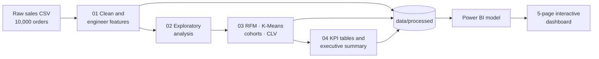
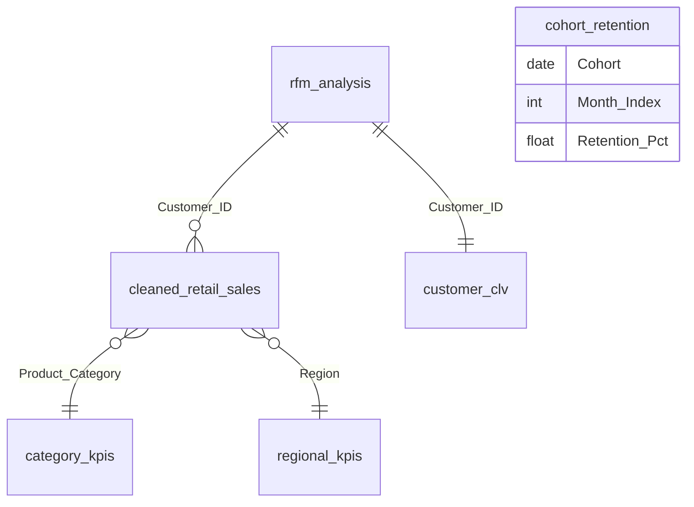

<div align="center">

# Retail & Marketing Analytics

### From 10,000 raw transactions to customer segments, retention curves and a 5-page Power BI dashboard


</div>

---

## Table of contents

1. [The question](#the-question)
2. [The business at a glance](#the-business-at-a-glance)
3. [What I found](#what-i-found)
4. [What I would recommend](#what-i-would-recommend)
5. [How the project fits together](#how-the-project-fits-together)
6. [The data, and what to know about it](#the-data-and-what-to-know-about-it)
7. [Methodology](#methodology)
8. [Mistakes I caught along the way](#mistakes-i-caught-along-the-way)
9. [The dashboard](#the-dashboard)
10. [Repository layout](#repository-layout)
11. [Run it yourself](#run-it-yourself)
12. [Limitations and next steps](#limitations-and-next-steps)
13. [Skills demonstrated](#skills-demonstrated)
14. [About me](#about-me)

---

## The question

A retail business has ten thousand orders and almost two thousand customers. It can see its total sales. What it cannot see from a total is **which customers are worth keeping, which are slipping away, and whether the ones who stay keep coming back.**

I took the sales file from raw data to a finished dashboard to answer that: clean it, explore it, group customers by behaviour in two independent ways, follow them over time, estimate what each one is worth, and put it all in front of a reader who can click through it.

---

## The business at a glance

| Metric | Value |
|---|---|
| Revenue | $1,078,670.98 |
| Orders | 10,000 |
| Customers | 1,986 |
| Average order value | $107.87 |
| Profit margin | 18.4% |
| Churn (no order in 180+ days) | 10.9% |
| Period covered | 1 Jan 2022 to 21 Feb 2023 |

Revenue figures use outlier-capped sales (see [Methodology](#methodology)) so a handful of very large orders do not distort the averages.

---

## What I found

**1. Two categories carry the revenue.** Electronics ($328,423, 30.5%) and Office Supplies ($321,281, 29.8%) bring in about 60% of it. Furniture ($214,958) and Clothing ($214,009) trail by roughly 35%.

**2. Revenue is spread thinly across the catalogue.** The top 20% of products (99 of 499) generate only 27.2% of revenue. There is no 80/20 concentration here, so there are no "hero products" to protect.

**3. Sales are flat, not growing or shrinking.** Across complete months, revenue stays between $72.7K and $82.7K (average $78.8K) with a month-on-month growth rate of -0.2% and no clear seasonal pattern. February 2023 looks like a collapse but is a partial month (the data stops on 21 February).

**4. 278 customers are quietly leaving.** The "At Risk" segment is 14% of the base. These customers used to spend well (about $698 each) but have not ordered in 126+ days on average. Together they represent roughly **$194K** of past revenue.

**5. A second method agrees with the first.** K-Means clustering, which knows nothing about my RFM scores, found three tiers that line up with them. That is good evidence the segments describe real behaviour rather than thresholds I picked.

**6. Customers who stay, stay.** About 69% of a cohort is gone after month 1, but month-1 to month-13 retention then settles into a stable 22–33% band instead of continuing to fall. Average retention is 31.4% at month 1 and 33.2% at month 3.

**7. Price and quantity pull in opposite directions; discounts do nothing visible.** Unit price and quantity are negatively correlated (-0.58): customers buy more units of cheap items. Discount shows almost no relationship with sales or profit (0.00 to 0.02).

**8. The South is the weak region.** It earns 33% less than the East ($212,070 vs $318,581) because it has fewer customers (1,257 vs 1,553) and each spends less, so the gap compounds.

**9. Lifetime value is concentrated.** Average projected CLV is $2,751, but 164 customers (8.3%) are projected above $5,000, and the top customer reaches $24,070.

### RFM segments

| Segment | Customers | Share | Avg days since last order | Avg orders | Avg spend |
|---|---:|---:|---:|---:|---:|
| Loyal Customers | 401 | 20.2% | 42.9 | 6.18 | $681.87 |
| Lost | 373 | 18.8% | 181.4 | 2.57 | $246.37 |
| Potential Loyalists | 362 | 18.2% | 84.7 | 3.97 | $389.48 |
| Champions | 353 | 17.8% | 19.4 | 7.70 | $856.46 |
| **At Risk** | **278** | **14.0%** | **126.3** | **6.10** | **$697.90** |
| New Customers | 219 | 11.0% | 20.8 | 3.25 | $347.07 |

---

## What I would recommend

| When | Action | Why |
|---|---|---|
| **Next 30 days** | Run a win-back campaign for the 278 At Risk customers | About $194K of past revenue, and these customers have already shown they will spend |
| **Next 2–3 months** | Find out why the South has fewer customers and lower spend; pilot a regional promotion | The gap to the East comes from both customer count and spend per customer |
| **Next 6–12 months** | Rethink discounting | I found no evidence that current discounts drive extra sales or profit |

---

## How the project fits together



Each notebook reads the file the previous one wrote, so the raw data is never edited in place.

The Power BI model keeps one fact table and joins the customer tables on `Customer_ID`:



`cohort_retention` stands alone on purpose: it is already aggregated by cohort month.

---

## The data, and what to know about it

The dataset is **synthetic**: 10,000 order lines, 1,986 customers, 499 products, four regions and four categories. Some quirks give it away, and they matter for how far the conclusions should be pushed:

- Sub-categories are assigned independently of categories (a "Clothing" row can carry "Binders"), so I left sub-category out of the final category view.
- Every order ships exactly one day after it is placed, so delivery performance cannot be analysed.
- A customer ID can appear with several different customer names, so `Customer_Name` was not used as an identifier.
- A 96.3% repeat-customer rate comes from the dataset's structure (about five orders per customer), not from a real-world benchmark.

I treat the findings as a demonstration of method on a realistic shape of data, not as claims about a real business.

| Column group | Fields |
|---|---|
| Identifiers | `Order_ID`, `Customer_ID`, `Product_ID` |
| Dimensions | `Segment`, `Region`, `Product_Category`, `Product_Sub_Category`, `Order_Priority` |
| Measures | `Sales`, `Quantity`, `Discount`, `Profit`, `Shipping_Cost`, `Unit_Price` |
| Dates | `Order_Date`, `Ship_Date` |

A full column list is in `docs/data_dictionary.csv`.

---

## Methodology

### 1. Cleaning (`notebook_01_setup`)

- Inspected shape, types, missing values and duplicates before touching anything. Found 30 missing `Profit` values and 50 missing `Customer_Name` values; no duplicates.
- Filled missing numbers with the **median** (robust to outliers) and missing names with `Unknown` rather than guessing a customer.
- Converted dates to real datetimes and low-cardinality text columns to categories.
- **Capped outliers instead of deleting them** with the 1.5×IQR rule: 328 `Sales` values (cap $275.33) and 87 `Profit` values. A very large order is a real customer, so the row stays and only its extreme value is tamed.
- Engineered year, month, quarter, day of week, weekend flag, delivery days and profit margin.

### 2. Exploratory analysis (`notebook_02_eda`)

Distributions, category and regional breakdowns, monthly trend, Pareto test on products, and a correlation matrix. Sales are right-skewed, which is why medians and capped values are used throughout.

### 3. Segmentation (`notebook_03_advanced_analytics`)

**RFM.** Each customer is scored 1–5 on Recency, Frequency and Monetary value using quintiles, then mapped to six named segments by rule. Recency labels are reversed because fewer days since the last order is better.

**K-Means.** I standardised the three RFM features (dollars and days sit on very different scales, and unscaled Monetary would dominate the distance) and tested k = 2 to 10:

| k | Silhouette (higher is better) | Davies-Bouldin (lower is better) |
|---:|---:|---:|
| 2 | 0.381 | 0.974 |
| **3** | **0.372** | **0.918** |
| 4 | 0.325 | 0.963 |
| 5 | 0.335 | 0.945 |
| 6 | 0.312 | 0.948 |

I chose **k = 3**: it has the best Davies-Bouldin score, a silhouette within 0.01 of the best, and k = 2 is too coarse for a customer base that clearly has more structure.

| Cluster | Customers | Avg days since order | Avg orders | Avg spend | Reading |
|---|---:|---:|---:|---:|---|
| 0 | 374 (18.8%) | 209 | 3.0 | $307 | Lost / dormant |
| 1 | 958 (48.2%) | 55 | 4.1 | $424 | Core |
| 2 | 654 (32.9%) | 47.5 | 7.5 | $852 | High-value |

**Cohort retention.** Customers are grouped by the month of their first purchase and followed for up to 13 months, giving a 14-cohort retention matrix.

**Customer lifetime value.** A deliberately simple model:
`CLV = average order value × purchases per year × 3 years`.

### 4. KPIs and summary (`notebook_04_kpis`)

Headline, monthly, category and regional KPI tables, plus a written executive summary in `outputs/reports/`.

---

## Mistakes I caught along the way

Most of the value in this project came from checking my own output. These are the ones that would have changed a conclusion:

| What looked wrong | How I noticed | What I did |
|---|---|---|
| CLV projected one customer at **730 orders a year** | The frequency column's maximum was physically impossible | Customers with a same-day first and last order were being annualised from a one-day window. I floored the observation window at 30 days. Average CLV fell from $7,521 to $2,751 |
| Profit margin ranged from **-336% to +574%** after capping `Sales` and `Profit` separately | Re-checked the ratio after the input fix barely moved it | A ratio can explode when the denominator is small even if neither input is an outlier. I capped the margin itself |
| February 2023 looked like a **31% sales drop** | The last point on the monthly chart fell off a cliff | The data ends on 21 February, so the month is incomplete. I excluded it from trend statements and labelled it on the dashboard |
| Customer table showed the same customer repeated under different names | Duplicate IDs with different names in a Power BI table | Dropped `Customer_Name` and used `Customer_ID` as the only identifier |
| Top-10 tables went blank when a segment slicer was clicked | Tested slicers before recording a demo | Replaced a fixed value cutoff with a rank measure that re-ranks inside the current selection |

---

## The dashboard

The Power BI file is `dashboards/retail_marketing_dashboard.pbix`. It has five pages. Each has KPI cards, filters, and a **Key Insights** line that rewrites itself from the current selection.

### 1. Executive Overview
Revenue, orders, customers, average order value, repeat and churn rate, the monthly revenue trend, revenue by category and by region. Filter by region or product category.


### 2. Customer Segmentation
The RFM segment donut, the three K-Means clusters compared on recency, frequency and spend, a segment summary table, and the top 10 At-Risk customers by spend. Filter by segment, cluster or order month.


### 3. Sales Deep Dive
Top 10 products by revenue, the price-versus-quantity relationship across 499 products, and a category breakdown.


### 4. Cohort & Retention
The 14-cohort retention heatmap and the average retention curve, which drops steeply after month 0 and then flattens.


### 5. Customer Value (CLV)
The CLV distribution, the top 10 customers by projected value, and the count of customers above $5,000.


### What is under the hood

- **Dynamic insight cards.** DAX measures built with variables and `FORMAT` read the current filter context and return a sentence, so the text changes as you click.
- **Ranking inside a selection.** Top-10 tables use `RANKX` over `ALLSELECTED`, so "top 10" always means top 10 *of what is currently selected*.
- **Cross-filtering across tables.** A bidirectional relationship between the customer table and the sales table lets a month slicer reach the segmentation visuals.
- **Readable cluster names.** A `SWITCH` column turns cluster numbers into labels.
- **Consistent design.** A single palette (deep slate page, teal cards, gold borders, white text) applied across all five pages.

---

## Repository layout

```
notebooks/        four Jupyter notebooks, meant to be run in order
data/raw/         the original sales file
data/processed/   cleaned data plus the RFM, CLV and cohort tables
outputs/reports/  executive summary, EDA findings and KPI tables
dashboards/       the Power BI file
docs/             dashboard screenshots and the data dictionary
requirements.txt  Python dependencies
```

| Notebook | What it does |
|---|---|
| `notebook_01_setup.ipynb` | Loads, inspects and cleans the raw data |
| `notebook_02_eda.ipynb` | Exploratory analysis |
| `notebook_03_advanced_analytics.ipynb` | RFM, K-Means, cohort retention and CLV |
| `notebook_04_kpis.ipynb` | KPI tables and the executive summary |

---

## Run it yourself

```bash
git clone https://github.com/CryptedBlade/retail-marketing-analytics.git
cd retail-marketing-analytics
pip install -r requirements.txt
jupyter notebook
```

1. Open Jupyter **from the project's main folder** so the relative paths resolve.
2. Run the four notebooks in order; each reads files the previous one created.
3. Open `dashboards/retail_marketing_dashboard.pbix` in Power BI Desktop. If it asks for the data location, go to **Transform data → Data source settings** and point each source at the matching file in `data/processed/` and `outputs/reports/`.

---

## Limitations and next steps

- **Synthetic data.** Findings demonstrate method, not real business results.
- **Simple CLV.** Even with the observation window fixed, this model can over-weight recently acquired, high-frequency customers. A probabilistic model such as BG/NBD with Gamma-Gamma is the proper next step.
- **No cost data.** Segment value is measured in revenue, not margin after marketing spend, so the win-back recommendation cannot yet be sized as a return on investment.
- **Short window.** Thirteen months is too short to see true seasonality.

---

## Skills demonstrated

**Data preparation** · missing-value strategy, outlier treatment, feature engineering
**Analysis** · EDA, correlation, Pareto testing, cohort retention
**Machine learning** · feature scaling, K-Means, choosing k with silhouette and Davies-Bouldin
**Customer analytics** · RFM, segmentation, lifetime value
**BI** · Power BI data modelling, DAX (variables, `RANKX`, `ALLSELECTED`, `SWITCH`, `FORMAT`), interactive design
**Judgement** · validating results two ways, and finding and documenting my own errors

---

## About me

I'm Harshvardhan Singh, a B.Tech student in Electronics and Computer Engineering aiming for data and business analyst roles.

[LinkedIn](https://www.linkedin.com/in/harshhhhhh) · [GitHub](https://github.com/CryptedBlade)
