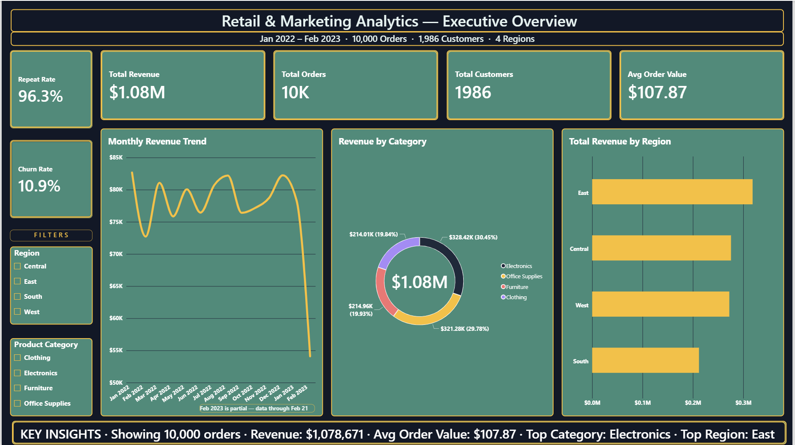
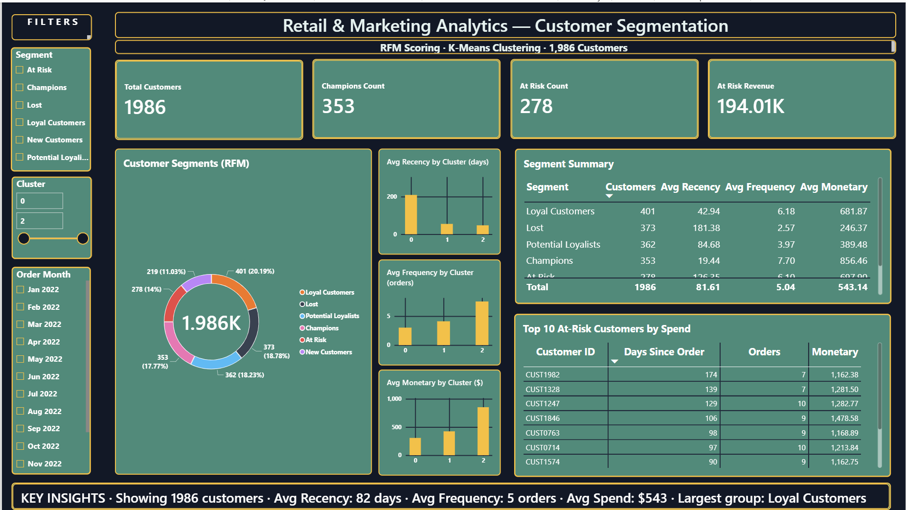
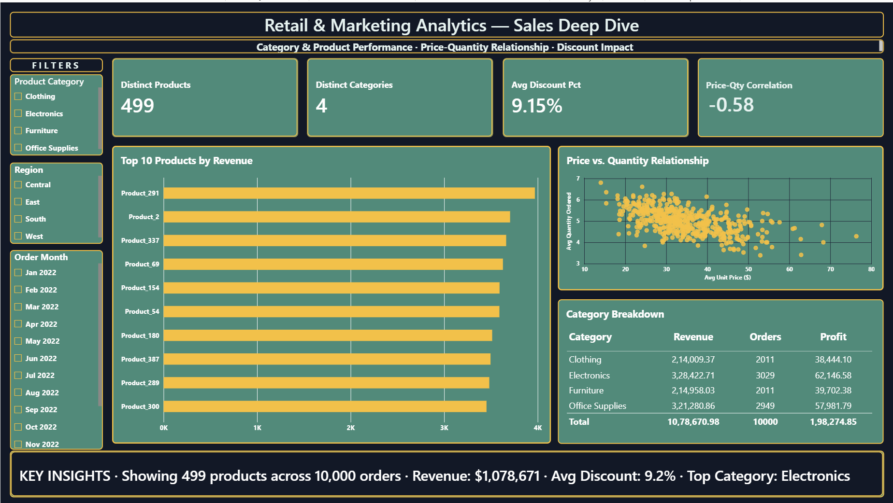
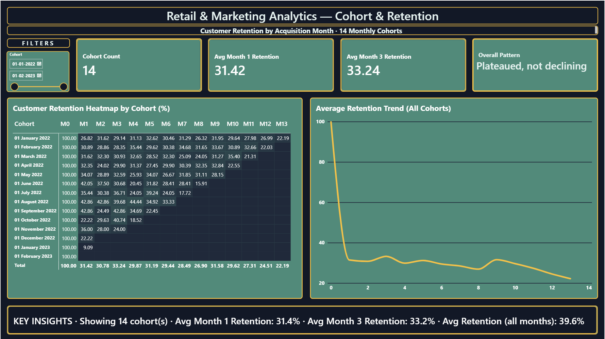
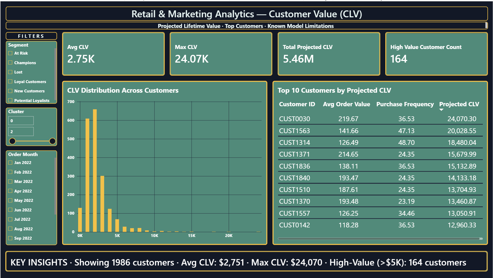

# Retail & Marketing Analytics

I wanted to see what a retail business's sales data could tell me about its customers, so I cleaned it, explored it, grouped the customers by behaviour and pulled the results into a five-page Power BI dashboard. This repo has the notebooks, the data at each stage, the written reports and the dashboard file.

## The business at a glance

| Metric | Value |
|---|---|
| Revenue | $1,078,670.98 |
| Orders | 10,000 |
| Customers | 1,986 |
| Average order value | $107.87 |
| Profit margin | 18.4% |
| Churn (no order in 180+ days) | 10.9% |

## What I found

Revenue leans heavily on two categories. Electronics ($328K) and Office Supplies ($321K) together bring in about 60% of it.

Month to month, sales are flat. Average growth is -0.2% with no strong seasonal pattern, so this looks like a steady business rather than one that's growing or shrinking.

The most interesting group is the "At Risk" customers. There are 278 of them (14% of the base). They used to spend well, about $698 each on average, but haven't ordered in 126+ days. Winning them back is where I'd start.

K-Means clustering, which doesn't know anything about my RFM scores, split customers into three tiers: Lost/Dormant (18.8%), Core (48.2%) and High-Value (32.9%). That's a good sign the RFM segments reflect real differences in behaviour and aren't just thresholds I picked.

The South region earns 33% less than the East. It has fewer customers and each spends less, so the gap compounds.

Discounts show almost no correlation with sales or profit (0.00 to 0.02), so the current discounting doesn't seem to be driving extra revenue.

## What I'd recommend

1. **Next 30 days:** run a win-back campaign for the 278 At Risk customers. Together they represent about $194K in past revenue.
2. **Next 2-3 months:** find out why the South has fewer customers and lower spend, and test a regional promotion.
3. **Next 6-12 months:** rethink discounting, since I couldn't find evidence it helps.

## How the repo is laid out

```
notebooks/        four Jupyter notebooks, meant to be run in order
data/raw/         the original sales file
data/processed/   cleaned data plus the RFM, CLV and cohort tables
outputs/reports/  executive summary, EDA findings and KPI tables
dashboards/       the Power BI file
```

## The notebooks

1. `notebook_01_setup.ipynb` loads and cleans the raw data.
2. `notebook_02_eda.ipynb` is the exploratory analysis.
3. `notebook_03_advanced_analytics.ipynb` covers RFM, K-Means clustering, customer lifetime value and cohort retention.
4. `notebook_04_kpis.ipynb` builds the KPI tables and the executive summary.

To run them yourself, first install the libraries with pip install -r requirements.txt. Each notebook reads files the one before it created, so run them in order, and open Jupyter from the project's main folder.

## The dashboard

The Power BI file is `dashboards/retail_marketing_dashboard.pbix` and opens in Power BI Desktop. It has five pages:

**Overview**



**Category breakdown**



**Sales**



**Cohort retention**



**Customer lifetime value**




## Tools

Python (pandas, scikit-learn, matplotlib, seaborn), Jupyter Notebook and Power BI Desktop.

## About me

I'm Harshvardhan Singh, a B.Tech student in Electronics and Computer Engineering aiming for data and business analyst roles. You can find me on [LinkedIn](https://www.linkedin.com/in/harshhhhhh) and [GitHub](https://github.com/CryptedBlade).
